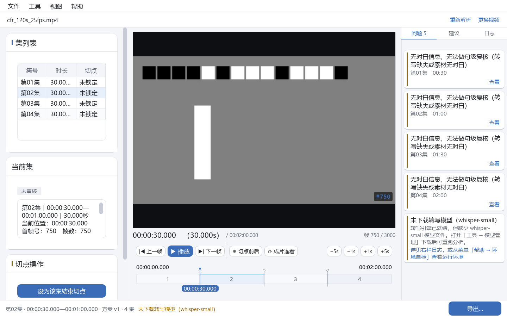

# AI 短剧智能分集器

按《AI短剧智能分集器 V1.2.0 可实施修订方案》落地的桌面工具。
本仓库是**阶段1（媒体与手动分集闭环）的完整实现**，并附阶段2 所需的约束求解与版本机制。

定位：AI 辅助分集、用户审核、程序精确导出。**默认不重排、不补拍、不生成对白。**

## 界面

**单页工作台**：一页三栏（左=上下文 / 中=舞台 / 右=检查器），四个阶段在同一页里
换屏，没有页面切换、没有步骤条。阶段由项目状态推导（`app/gui/stage.py`）：

| 阶段 | 判据 | 左栏 | 中栏 | 底栏主动作 |
| --- | --- | --- | --- | --- |
| 空态 | 无媒体 | 隐藏 | 拖放 hero | 选择源视频… |
| 就绪 | 有媒体无方案 | 素材（源文件/媒体摘要/音轨） | 预览 + 整片时间轴 | ▶ 开始分析 |
| 分析中 | 分析线程在跑 | 只读 | 阶段 n/7 + 进度 + 最近输出 | 取消分析 |
| 审核 | 有方案 | 集列表 + 当前集 + 切点操作 | 预览 + 时间轴（切点/锁定/播放头）+ 播放控制 | 导出… |

右栏检查器常驻：兼容性问题、方案层校验、逐集复核风险、后台日志，各只有一处
（原先导入区与检查器各列一份问题清单、分析日志也两处显示）。设置 / 模型 / 导出
是**对话框**（菜单「工具」），不占工作区。

**视觉体系**（`app/gui/theme.py`，浅深两套令牌同步维护）：

| 类别 | 取值 | 说明 |
| --- | --- | --- |
| 圆角 | 6 / 10 / 16 / pill | 输入框 / 按钮 / 卡片 / 胶囊；输入框圆角必须 ≤ 高度/2 |
| 字号阶 | 11 / 13 / 15 / 18 | caption / body / title / display |
| 间距网格 | 4 / 8 / 12 / 16 / 24 | 消除随手写的 10 / 14 / 18 |
| 层次 | 卡片底边 2px `SHADOW_EDGE` | **Qt 的 QSS 没有 `box-shadow`**，纵深只能靠底边伪造 |

彩色只出现在小面积元素上：卡片标题左侧的语义色条（`Card(accent=...)`）与状态胶囊
（`StatusPill`）。大面积色块在 QSS 里最容易失控——圆角处露底、深浅两套难同步。

**结构化日志**（`app/gui/widgets/log_panel.py`）：彩色级别点 + 等宽时间戳 + 自动换行正文。
**整集复核对每一集都写一遍除集号外逐字相同的结论**（四集就是四条 60 字的重复），
这类**连续且仅集号不同**的条目折叠成一条 + `×N` 胶囊，点开看全。不跨时间折叠——
把整场分析的同类结论隔空合并，用户会以为中间漏了信息。`toPlainText()` 仍输出
**原格式**，折叠不丢信息。保留最近 800 条，更早的收起成一行。

**左栏不出横向滚动条**：`scrollable()` 显式关闭横向并把子控件最小宽度清零。原先
横向策略是「按需」，左栏内容最小宽度超过 320px 就出横滚动条，**所有文字被裁**。
真正需要横向的预览控制条走 `h_scrollable()`。

**轻量时间轴**（`app/gui/widgets/timeline.py`）：整片时长条 + 集分段（圆角 + 2px 缝，
已导出的集右上角一枚圆点）+ 切点标记（锁定实心 / 异常标红）+ 播放头，可直接拖动
切点（松手先吸附到帧起点再换算 ticks）、点击跳转与选集。不做帧缩略图。绘制分静态层
（缓存 QPixmap，仅尺寸/主题/方案/选中集变化才重建）与动态层（只重绘播放头），
播放时每帧刷新不会重建整条。

截图由 `tools/screenshot_gui.py` 离屏渲染真实界面得到，预览区显示的是 FFmpeg
解出的**真实解码帧**（可见测试素材自带的帧号条码）。

| 页面 | 截图 |
| --- | --- |
| 空态（未导入） | [01-空态](docs/screenshots/01-工作台-空态.png) |
| 素材就绪 | [02-素材就绪](docs/screenshots/02-工作台-素材就绪.png) |
| 分析中 | [03-分析中](docs/screenshots/03-工作台-分析中.png) |
| 审核（时间轴） | [04-审核](docs/screenshots/04-工作台-审核.png) |
| 设置（对话框） | [05-设置](docs/screenshots/05-设置.png) |
| 模型（对话框 · 本地） | [06-模型](docs/screenshots/06-模型.png) |
| 导出（对话框） | [07-导出](docs/screenshots/07-导出.png) |
| 云端厂商（模型管理里的页签） | [08-云端厂商](docs/screenshots/08-云端厂商.png) |
| 模型设置（两条能力各选一个模型） | [09-模型设置](docs/screenshots/09-模型设置.png) |



审核要求「连看切点前后」，因此提供三种检视方式：播放整集、播放切点前后 ±3 秒、
以及**用已导出的成片连看相邻两集**（后者能发现编码层面的衔接问题，前者只能验证规划）。
播放时能听到原声：画面是 FFmpeg 解帧直出（逐帧准确），声音由并行的 `ffplay`
只放音频，与画面一起启停；放的是左栏选中的那条主对白轨。这套 FFmpeg 若没带
`ffplay`（精简构建），预览会自动退回无声，不影响画面与导出。两条时钟的起播差
用 `ffplay` 自己报的进度行做一次性对齐，画面解码宽度跟着画面区走——见下面第 13、14 条。

## 模型下载（界面内完成）

应用内置「模型管理」对话框（菜单 **工具 → 模型管理…**），用户可直接在界面里选择并下载所需模型，
**不需要命令行**。

| 类别 | 可选档位 | 用途 |
|---|---|---|
| 语音转写 | whisper tiny / base / small / medium / large-v3 | 对白转写与句末候选 |
| 语义判断 | Qwen3.5-2B / 4B / 9B × 各量化档位（档位列表从远端发现，不写死） | 切点语义判断 |

界面提供：

- **按用途分成两组卡片**（语音转写 / 语义判断），每行自带动作按钮——未装→下载、
  已装→删除，不需要"先选中一行再去点底部按钮"；
- **「使用中」可切换**：每行一个圆钮（仅已安装行可点），标着「使用中」的那一个
  才是分析时真正会用的模型。转写档位与语义档位都记进 `config.json`，
  重启后仍然生效；组标题右侧写明"使用中：whisper-small"，若它没装会红字提示
  "分析会跳过转写"（不静默换档）；
- **每个模型的实测体积与安装状态**（已安装 / 不完整 / 未安装）；
- **模型目录可更改并记住**（默认 exe/项目根下的 `models/`；环境变量
  `DRAMA_MODELS_DIR` 优先级更高）；
- **磁盘可用空间提示**，下载前再检查一次，空间不足会明确拒绝而不是写到一半失败；
- **实时进度**（按已下载字节），取消后清理临时文件；
- **删除**只删该模型自己的目录。

两类模型相互独立，可只装其一；未安装时对应能力自动跳过并在日志中说明原因。
语义判断的「使用中」只在本地路径生效（走 Ollama / 进程内 llama.cpp）；
若把该项能力切到云端，则由厂商 API 承担，本地档位只在该能力回退本地时才用得上。

## 环境自检（菜单「帮助 → 环境自检…」）

一页列出本机运行环境每项是否就绪，并对**能修**的项给出按钮：

| 检测项 | 判定 | 缺失时能做什么 |
|---|---|---|
| FFmpeg 工具链 | 阻断 | 只能给下载页（应用内不下载 FFmpeg） |
| 预览声音（ffplay） | 降级 | 只影响预览出声，画面不受影响 |
| 语音转写引擎（faster-whisper） | 阻断 | **可一键安装**（应用内下载官方 wheel，约 80 MB） |
| 转写模型（whisper） | 阻断 | **可一键下载**（引擎就位时才给按钮） |
| 语义模型 / 推理栈 | 降级 | 语义模型可下载；推理栈给发布页（有预编译轮子） |
| 镜头检测 / 繁简 / 字幕解析 | 降级 | 缺失时对应能力跳过（scenedetect 给发布页） |
| 模型目录 | 阻断 | 不可写时跳到模型管理 |

**可修能力**分两种，都在应用内真装：

- `download_model`：下载**模型文件**（走 `model_manager`，用 curl）；
- `install_engine`：安装**运行期依赖**（走 `deps_manager`，下载官方预编译
  wheel 解压到 exe 同级的 `deps/`）——语音转写引擎走这条，**不需要 pip、不需要
  编译器**。实测在冻结的 exe 里，装好后能真正完成中文语音识别。

**排障入口**：`run.py --deps-report`（打包版即 `drama-splitter.exe --deps-report`）
逐个导入全部外挂包并打印真实异常与调用链，用来分辨"装是装了但用不了"是哪一层断的。

**诚实边界**：能修的一定给按钮，修不了的（FFmpeg、部分可选包）只给指引，
不假装能修。两条与"缺包"相关的规矩：

1. 缺引擎时**模型项收起下载按钮**——下模型解决不了缺包，免得用户白等几个 GB；
2. 缺引擎时**给的是 `install_engine` 而非 `download_model`**——同样是"下模型
   解决不了缺包"。

**只读**：打开自检只跑检测，不创建目录、不下载、不安装；修复一律要用户点按钮。
检测在后台线程跑（含 `ffmpeg -version` 探测），不会冻结界面。

### 云端模型（厂商 API，默认关闭）

除了本地模型，**语音转写与语义判断**也都可以走厂商 API：**厂商可自定义**，预置十几家
（国内 DeepSeek / Kimi / 智谱 / 百炼 / 混元 / 硅基流动 / 星火 / 阶跃，海外 OpenAI / Groq /
Mistral / DeepInfra / OpenRouter，自建 Ollama / LM Studio，以及火山方舟）。配的是厂商
档案（接口地址 / Key / 协议），都在 **工具 → 模型管理… → 云端厂商**；**用哪个模型**在
**工具 → 模型设置…**。协议与厂商解耦，设计见
[docs/云端模型接入_设计.md](docs/云端模型接入_设计.md) §11。

**厂商是数据，协议是信封**：加一家厂商 = 加一份预置数据（`DEFAULT_PROFILES`），
只有新增一种*协议*才需要写适配器。协议是封闭集合：

| 协议 | 覆盖什么 | 说明 |
|---|---|---|
| **OpenAI 兼容** | 对话补全 `/chat/completions`；音频转写 `/audio/transcriptions` | 绝大多数厂商都提供；转写固定带 `response_format=verbose_json` + `timestamp_granularities[]=word` |
| **火山方舟** | 豆包「大模型录音文件识别极速版」 | 转写专有协议；方舟的语义判断本身是 OpenAI 形态，走上一行 |
| 停用 | — | 该能力不配云端 |

- **一家厂商都在一页里**（「模型管理 → 云端厂商」）：左列表选厂商，右侧填名称 /
  接口地址 / 两条能力各自的协议 / API Key / 允许外发；火山专用的 endpoint 与资源 ID
  只在选了火山转写时出现，id 与代理折叠在「显示高级字段」里（点「新增」会自动展开；
  必填项不会被藏起来）。Key、外发许可、能力开关、模型名**只有这一处**能改——
  早先它们分散在「模型管理」的云端卡片与独立的「厂商管理」对话框里，同一份档案
  两处都能改，实测会撞上"到底哪个算数"。
- **厂商可增删改**：「新增 / 复制为自定义 / 删除 / 恢复默认」；内置厂商 id 不可改、
  不可删（可改字段或恢复默认），删除/恢复会把引用它的能力回落本地。
- **模型清单可以筛选**：切换厂商或改完地址 / Key 会自动拉一次该厂商的
  `GET {base_url}/models` 填进表格（同一厂商第二次进直接读内存缓存，也可点
  「刷新模型列表」强制重取；接口不给清单或请求失败会如实说明）。表格是
  **筛选框 + 单选列表**：模型名拿回整行宽度，几百个模型的厂商靠筛选框定位，
  选中后再点「设为语义判断 / 设为转写」指派，当前指派的带 ● 标记。
  （早先是"每行并排两个按钮"，模型名被按钮挤成省略号、一屏只剩四五行。）
  清单里没有的名字可以在下方**手动添加**——它会记住（存进该厂商档案的
  `custom_models`，可单独删除），方舟的推理接入点 ID（`ep-xxx`）、自建网关的别名就靠这个。
- **每条能力一个下拉**（「工具 → 模型设置…」）：语音转写、语义判断各一张卡，
  **本机已装的模型排在最上面，云端按厂商分子组在下**——**两条能力各选各的，混着用
  是常态**（转写本地 + 判断云端，或反过来）。选哪一条，后端就是哪边，所以卡上不再有
  「本地 / 云端」切换按钮，后端改成标题右侧一枚只读徽章。
  本地一侧只列**已安装**的模型（配置指向却没装的会标注「未安装」）；云端一侧只给
  **配了 Key 的**厂商单独成组（当前生效的排最前），其余合并成一条
  「另有 N 家厂商未配置 Key」而不是悄悄藏起来。右下角「去配置 Key…」直达
  「模型管理 → 云端厂商」，状态行里的「去下载」直达「模型管理 → 本地模型」。
  这里只选模型：厂商的地址与 Key、模型的下载都不在这一页。
- **下拉可搜索、也能手输**：几百个云端模型靠点框输入过滤，不用再摆一个筛选框；
  方舟的 `ep-xxx`、自建网关的别名不在任何 `/models` 里，直接打进去即可
  （归属厂商不唯一时会先问，不替你猜）。
- **选中即生效，没有保存按钮**：下拉里展开浏览不改值，只有真选中才写盘。
  状态行**先给结论再给细节**：第一行说清此刻到底跑什么——本机没装且云端没生效时
  直接写「这条能力不会执行」，而不是把"生效的"和"刚选的"连成一句近百字的话。
- **厂商页只留「填 Key + 加模型」**：接口地址、两条协议、火山专用字段、id、代理
  全部收进「显示高级字段」——十几项摊在首屏时，每一项都像必填。保存校验若发现
  缺必填项会**自动展开**该区并指名缺什么，不会"看不到却必须填"。
- **每个模型可单独配参数**：选中模型 → 下面是它的**上下文窗口 / 思考等级 / 模态**。
  填了就直接生效：上下文窗口用于裁剪送模型的输入（为回复预留四分之一窗口，
  裁过会在输入里留一行标记），思考等级作为 `reasoning_effort` 下发，模态决定
  它能不能被指派给语义判断（要文本）或语音转写（要音频）——指派冲突当场提示，
  不等到分析时才发现。表格行尾直接显示 `128k·思考·low·文本+图像`。
- **自动填充只填有把握的**：「自动填充」按内置知识库（GPT / Claude / Qwen /
  DeepSeek / Kimi / 豆包 / 智谱等）与名称模式（`-128k` 后缀、`vl` 判图像、
  `whisper`/`paraformer` 判音频、嵌入模型直接标不可用）推断。**认不出就留空**——
  留空 = 不干预（不截断、不发 `reasoning_effort`、不做模态过滤），所以按一下
  自动填充不会把原本能用的模型弄坏。已手填的值不会被推断覆盖。
  （`reasoning_effort` 只对确定支持的 OpenAI o 系列 / gpt-5 自动填；deepseek-reasoner
  这类自带思考但不吃该参数的模型一律留空，盲传会 400。）
- **默认零外发**：档案默认未启用、未勾选「允许外发素材」；两个开关任一为关，
  分析时不会向厂商发任何素材请求，并在日志里说明"选了云端但没生效"的具体原因。
  （「模型设置」选云端时会拿 Key 去查该厂商的 `/models` 清单——只查清单，
  不带任何素材内容；没填 Key 的厂商连这个请求都不会发，直接提示去配置。）
- **两条能力各自独立**：转写与语义判断分别勾选、分别测连通、分别切换；
  转写测不通不影响已测通的语义判断。
- **外发范围写在界面上**：转写＝**整条音轨**（按 600 秒分块上传，优先压成 mp3，
  单块约 5MB）；语义判断＝**候选点前后的台词文本片段**（不含画面）。每次分析都会
  在检查器记一条外发流水（音频时长 / 块数 / 文本请求数 → 主机名）。
- **必须测通才允许启用**：点「保存并测试连通性」通过后才切到云端，
  避免"以为通了、真正分析时才回退本地"。转写的连通性用 1 秒静音样片探测
  （不读用户素材、不依赖 ffmpeg），厂商对静音的返回码 `20000003` 同样证明
  Key 与资源权限是通的；OpenAI 兼容转写若拒绝静音样片，会退化为 `GET /models`
  验鉴权，并在日志里如实写明"只验证了鉴权、没验证模型"。
- **失败不致命**：云端不可用（鉴权、限流、断网、额度）自动回退本地并说明原因
  （转写会说清是第几段失败，然后整体回退本地重跑，不做"半云端半本地"拼接），
  不会把整轮分析判为失败；"仅云端"模式下则如实降级为规则评分 / 跳过转写。
- **本地管线一条都不重写**：分块（静音吸附）、抽音、块起点偏移回填、跨块去重、
  句子重建、缓存全部沿用本地同一套代码，云端只换"每块怎么转写"这一处；
  缓存按后端隔离，换后端不会复用旧转写。
- **时间戳的降级是明说的**：厂商给了 `words[]` 就用词级时间戳；只给分句的
  （如 SenseVoice）合成为分句级并记 `ASR_NO_WORD_TIMESTAMPS` 风险；
  **给了文本却一个时间戳都没有则直接报错**——绝不静默当成"这段没有语音"。
- **Key 不落日志、不进方案快照**：可存本地 `config.json`（明文，界面有标注），
  也可用环境变量 `DRAMA_<厂商 id>_API_KEY`（如 `DRAMA_VOLC_API_KEY`）覆盖，
  部署场景更可控；云端厂商页里的 Key 输入框，其提示文字就是该厂商的环境变量名。
- 接入一个**新协议**（例如某家的原生转写）= 写一对 `JudgeTransport` / `AsrTransport`
  + 在 `app/core/cloud.py` 的协议表里登记一行，调用方与核心算法不动；
  接入前须自证**词级时间戳**，否则只能按质量降级处理。

### 下载链路上的三个硬约束（都是实测踩出来的）

1. **必须用 curl，不能用 Python 的 urllib** —— hf-mirror 会 403 拒绝
   `Python-urllib` 的 User-Agent。
2. **不能用 huggingface_hub 的缓存** —— 它的缓存依赖符号链接，本机账户没有
   该权限，会产出 0 字节占位文件。因此直接下载真实文件到普通目录。
3. **取远端体积必须解析 `Content-Length` 头**，不能用 curl 的
   `%{size_download}` —— HEAD 请求按定义不下载响应体，该值恒为 0，
   表现为"总大小永远未知"、进度条与磁盘预检静默失效。

下载逻辑只有一份实现（`app/core/model_manager.py`），
`tools/fetch_whisper_model.py` 与 `tools/fetch_llm.py` 是它的命令行入口。

## 应用内更新

「帮助 → 检查更新…」会在应用内走完整套升级，不必自己去 Releases 页面找文件：

1. **检查**：读仓库的 `releases/latest`（公开接口，无需鉴权），与当前版本比较；
2. **下载**：curl 断点续传，落盘前先看磁盘余量；
3. **校验**：比对发布页给出的 SHA-256，**不通过就删掉**，绝不把文件交给安装器；
4. **安装**：`/VERYSILENT` 静默安装；装完由 `tools/installer.iss` 的 `[Run]`
   （`RelaunchRequested`，靠更新器传的 `/RESTARTAPP=1` 触发）把**新版自动拉起来**；
5. **回报**：升级前记下「预计装到哪个版本」，新版首次启动时对账，报一句
   「已更新到 x.y.z」——中途取消安装就不会误报。

下载体验（v1.0.11 起）

- **慢速自动换源**：候选**连上了但太慢**也会换——平均速度低于 200 KB/s 且已跑满
  15 秒，就当作「这条不行」切下一条（已下载部分保留、继续续传）。为什么必须有它：
  实测官方直连 0 B/s、API 地址 ~58 KB/s、`gh-proxy.com` 5 MB/s，只按「失败」切换的话
  用户会一直卡在慢的那条上（35 MB 要下好几分钟）。最后一条候选没有「下一个」可换，
  所以慢也会让它下完，不会把用户卡在半路。
- **下载优先走可达的那条路**：官方下载地址在 `github.com`，实测在部分网络下
  **完全连不上**（应用里 21 秒超时；本机也只有 ~48KB/s），而 Release API 给的资产地址
  （`api.github.com/.../releases/assets/<id>` → 302 → CDN）通常能连上。所以下载会先试
  API 地址，再回退官方地址。
- **直连都不行时自动回退内置加速源**：`gh-proxy.com`（实测 5.3 MB/s，8 秒下完 35.8 MB
  安装包）→ `ghproxy.net`（62 KB/s）。界面会写明这次走的是哪个来源。**镜像只影响传输**：
  装之前仍按发布页的 SHA-256 逐字节校验，镜像无法塞进被篡改的包。想彻底关掉内置源，
  在 `config.json` 里设 `"update_mirror": "off"`；想指定自己的镜像就填它的前缀。
- **说明不再糊一屏 Markdown**：更新窗口会把发布说明**渲染**出来，默认只露几行（点
  「展开完整说明」看全），状态行直接告诉你**这一版改了什么**（取说明里的第一个标题）。

- **真实进度**：下载过程中每 0.2 秒刷新一次「已下载 / 总大小 · 速度 · 剩余时间」；
  发布页没给大小时进度条转「不确定」模式，只报已下载量，不假装有百分比。
- **不设总时限**：只保留「30 秒内低于 1 KB/s 判定卡死」这一条。以前 curl 带着
  30 秒的**总**时限，而国内直连 GitHub 实测只有几十 KB/s——结果每 30 秒就被掐断
  一次，用户看到的永远是「下载超时」，怎么点都下不完。
- **断点续传**：取消或中断**不删**已下载的部分，按钮变成「继续下载」，接着下即可；
  真正的「完成」只认最终文件，最后还要过 SHA-256 校验。
- **下载慢可以配镜像**：在 `config.json` 里加一行 `"update_mirror"`：

  ```json
  { "update_mirror": "https://你的镜像前缀/" }
  ```

  下载地址会变成「镜像前缀 + 原始 GitHub 地址」，也支持 `{url}` 占位
  （例如 `https://m.example/?u={url}`）。**镜像只影响传输**：安装前仍然按发布页
  给出的 SHA-256 逐字节校验，所以镜像无法塞进被篡改的包。默认空 = 直连 GitHub。

几条刻意的边界：

- **只检查，不静默下载、不静默安装**：联网只发生在启动时那一次检查（每天最多一次，
  由 `config.json` 的 `extra.update_checked_at` 记账）和你点「下载并安装」之后；
- **失败不打扰**：启动检查遇到断网 / 限流 / 404 一律静默，只有确有新版才提示；
- **关掉弹窗也找得回来**：有新版时菜单项变成「检查更新（有新版 x.y.z）」，顶栏也会
  多一个入口——只弹一次的话，用户点了「稍后」就再也看不到这件事；
- **「跳过这一版」只跳过当前版本**，出了更新的版本照样提示；
- **免安装版不自动覆盖**：zip 会下载并解压到临时目录，界面给出「覆盖到哪个目录」的
  指引；替不替、什么时候替由用户决定（运行中的 exe 覆盖不了自己，目录里还混着
  用户的 `models/`、`cache/`、`config.json`）。

## 打包与部署

打包是**构建期**动作，PyInstaller 不在 `requirements.txt` 里（它只在打包时用得上，
装进运行依赖只会拖慢所有人的安装）：

```bash
pip install pyinstaller
python tools/build_package.py

# 产物自检（用于装机验收，看返回码）
dist/drama-splitter/drama-splitter.exe --self-check    # 运行前提
dist/drama-splitter/drama-splitter.exe --ui-smoke      # 界面完整性
```

产物是 onedir 形态，约 **124 MB**（已排除 faster-whisper / scenedetect /
llama_cpp 等延迟导入的重型可选依赖，否则会到数百 MB），目录形如：

```
dist/drama-splitter/
  drama-splitter.exe    ← 双击即启动，无控制台窗口
  _internal/            ← Python 运行时与全部模块（只读，勿手动改动）
```

`--ui-smoke` 是**必需**的一项：`--self-check` 根本不碰界面，漏打 Qt 插件或
界面模块时它照样"通过"，而用户双击才崩。`--ui-smoke` 会离屏构建整个界面
并走一遍模型页。

打包脚本还会核对一件两个自检都覆盖不到的东西：**`_internal/zhconv/zhcdict.json`**
（繁简转换的词典）。PyInstaller 只把 zhconv 的**代码**冻进产物，不会自动带上它的
词典数据；而 `--self-check` / `--ui-smoke` 都不碰繁简转换——v1.0.7 就是这样漏掉的：
装出来的程序界面照常打开、两项目检全绿，用户一跑「分析」才报
`FileNotFoundError: ...\_internal\zhconv\zhcdict.json`，整次分析白跑。现在收不到
词典直接让**构建失败**，产出来之后还会再查一遍文件在不在。

构建时另请留意 PATH：PyInstaller 会按 PATH 解析 DLL 依赖，PATH 里若有别的 Qt / ICU
目录（例如某个工具自带的 poppler），那些不兼容的 DLL 会被一并打进 `_internal/`，
症状是程序启动即 `DLL load failed while importing QtWidgets`。`--ui-smoke` 能拦住这类
产物（返回码非 0），所以别跳过它。

⚠️ **产物是 `--windowed` 编译的 GUI 子系统程序，没有控制台**，因此这两个自检
在打包版里**看不到任何文字输出**（进程内 `sys.stdout is None`，`print()` 是空操作）。
它们只通过**返回码**表态：0 = 通过。需要看详细报告时用源码运行
`python run.py --self-check`。

另需注意：`--ui-smoke` 走的是 Qt 的 offscreen 平台，**不覆盖 `qwindows` 平台插件**。
所以"打包验收"还必须补一步真实启动：双击 exe，确认主窗口出现、标题为
"AI 短剧智能分集器"。漏打 `qwindows.dll` 的产物能通过上面两个返回码，却在双击时崩。

自检会逐项报出：FFmpeg / FFprobe 路径、可用的硬件编码器、转写模型、
语义模型与推理栈状态。任一项缺失都给出可操作的下一步命令。

配置、缓存与模型目录都写在 **exe 同级**（`config.json` / `cache/` / `models/`），
不会写进 `_internal/`——装进 Program Files 时那里是只读的。

前端目录 `tools/` 下的脚本（素材生成、评测、模型下载）不随包分发，
打包版只包含界面与精确切割所需的运行时。

## 当前实现范围

已完成（可运行、可验证）：

| 方案条款 | 实现位置 | 状态 |
| --- | --- | --- |
| §9.1 真实时间轴（有理数 + 源时间基准整数 ticks） | `app/core/timebase.py`、`probe.py` | 完成 |
| §2.2 / §9.3 媒体探测、VFR/HDR/多音轨/非零 PTS 诊断 | `app/core/probe.py` | 完成 |
| §4 / §5 分集模式、参数规则、可行性与末集处理 | `app/core/settings.py` | 完成 |
| §5.3 剩余时长约束 | `app/core/settings.py::remaining_feasible` | 完成 |
| §9.2 连续覆盖（边界数组 + 共享边界） | `app/core/plan.py` | 完成 |
| §13.3 帧边界吸附与编辑拦截 | `plan.py::snap_to_frames` / `move_boundary` | 完成 |
| §12.3 方案版本、锁定切点、差异比较 | `plan.py`、`app/gui/state.py` | 完成 |
| §14 精确裁切导出、事务式落盘、失败重试 | `app/core/export.py` | 完成 |
| §14.5 计划/视频/边界/音频/时长五层校验 | `export.py::verify_episode_output` | 完成 |
| §12.1/§12.2 缓存：内容指纹、缓存键、一致性 | `app/core/cache.py` | 完成 |
| §7.2 字幕解析、时间合法性、偏移校正 | `app/core/subtitles.py` | 完成 |
| §7.1/§7.3 语音转写、VAD、词级时间、分块偏移 | `app/core/asr.py` | 完成 |
| §8.1 镜头切换与黑场检测 | `app/core/shots.py` | 完成 |
| §8.2/§8.4 候选数据库：收集、合并、评分、限流 | `app/core/candidates.py` | 完成 |
| §13.1 工作流界面（单页工作台：三栏 + 四阶段状态推进；设置/模型/导出为对话框） | `app/gui/workbench.py`、`app/gui/main_window.py` | 完成 |
| §13.3 帧级预览（解码帧驱动，非播放器近似） | `app/gui/frame_source.py` | 完成 |
| §16 阶段1「不依赖 AI 也能正确剪出指定区间」 | 全部 | 验收通过 |
| §16 阶段3「自动基础分析 → 候选数据库」 | `asr/shots/subtitles/candidates/audio/cache` | 验收通过 |
| §6.1 规则草案兜底路径 | `app/core/planner.py` | 完成 |
| §10.1–10.2 候选图 + 动态规划 | `app/core/solver.py` | 完成 |
| §11 语义判断、请求校验、预算与降级 | `app/core/semantic.py` | 完成（模型接口就绪，推理栈待接入） |
| § 云端模型（厂商 API，默认关闭；协议化多厂商 + 云端厂商页签 + 模型设置窗口 + 每模型参数档案，转写 + 语义判断） | `app/core/providers.py`、`model_info.py`、`cloud.py`、`cloud_http.py`、`cloud_openai.py`、`cloud_volc.py`、`cloud_asr.py`、`semantic.py::CloudLlmJudge`、`app/gui/panes/provider_form.py`、`model_setup_form.py` | 完成（真机冒烟待跑，需 Key） |
| §11 事件索引与整集复核 | `app/core/semantic.py` / `review.py` | 完成 |
| § 三种策略（剧情/悬念/时长） | `solver.py` | 完成 |
| § 推荐方案：分析后自动判定集长与集数（内容单元节拍 + 归一化打分 + 粗到精搜索） | `app/core/auto_timing.py` | 完成 |
| §7.2 单集字幕导出（SRT） | `app/core/episode_files.py` | 完成 |
| §14.2 快速复制（关键帧对齐流复制） | `app/core/export.py` | 完成 |
| §12.2 缓存按源失效（重算） | `app/core/cache.py` | 完成 |
| §9.3 完整帧表（VFR 地基） | `app/core/probe.py` | 完成（生成与核验；导出仍要求 CFR） |
| §15 硬件编码器探测 | `app/core/ffmpeg.py` | 完成 |
| § 任务恢复（项目快照）+ §五十五/五十六 保存 / 打开 / 自动保存 | `app/gui/state.py`、`app/gui/main_window.py` | 完成 |
| §37 导出前置检查（未审核切点不禁止：继续导出 / 返回审核） | `app/gui/panes/export_form.py::export_precheck` | 完成 |
| §19（自定）轻量时间轴：切点标记 / 锁定 / 播放头 / 拖拽改切点 | `app/gui/widgets/timeline.py` | 完成（不含帧缩略图） |
| § 四阶段状态机（空态 / 就绪 / 分析中 / 审核） | `app/gui/stage.py` | 完成 |
| §54 快捷键（空格/←→/Ctrl+S/O/E、回车确认、N/P 问题巡航、F11 全屏/Esc 关闭） | `app/gui/main_window.py::_install_shortcuts` | 完成 |
| §15 打包与部署自检 | `tools/build_package.py` + `run.py --self-check` | 完成 |

已知限制（不静默蒙混，都在界面上如实说明）：

- **语义判断默认本地、可切云端**：本地路径（GGUF + llama.cpp → Ollama）在本机装不上
  推理栈时长期降级运行（本机实测：llama-cpp-python 曾无匹配轮子且无编译器）。官方发布页
  现有 `py3-none-win_amd64` 预编译轮子（不挑 Python 版本，CPU 版约 7 MB），环境自检的
  「本地语义推理栈」一项因此给出「打开下载页」按钮，用户可自行下载安装；也可改用 Ollama
  或「模型 → 云端模型」里的厂商 API。降级时候选保持规则评分、审核状态保持 pending，
  并在日志里说明原因。
- **VFR 素材**：完整帧表已可生成与核验，但导出链路仍**要求 CFR**——
  VFR 在导入阶段被识别并拦截在精确导出之外（§9.3），不会静默错位。
- **HDR 转换**：不做，源片 HDR 属性在导入阶段给出警告。
- **快速复制**：要求所有集间切点都落在关键帧上，否则明确拒绝（不静默降级为重新编码）。
  实测关键帧通常每 250 帧（约 10 秒）一个，因此实际可用的切点位置受限。
- **时间轴不做帧缩略图**：只画集分段、切点与播放头。1 小时 1080p 约 10.8 万帧，
  直读必卡，需要另建缩略图金字塔与缓存策略，属后续独立模块。
- **手工移动切点不新建方案版本**：与既有实现一致，只把 `plan.source` 标为 `manual`
  并立即重检（方案版本链仍由自动规划与"另存为新版本"产生）。
- **分析中只报阶段与最近一条输出**：完整日志在右栏检查器的「日志」页签（唯一落点）。

## 环境

- Windows（其他平台应可运行，未验证）
- Python 3.12+（本机实测 3.14.6）
- **FFmpeg**（实测 9.0 full build，需含 `libx264` 与 `aac`）
  查找顺序：显式目录 → 环境变量 `DRAMA_FFMPEG_DIR` → `PATH` → 已知安装位置

## 安装与运行

```bash
# 依赖（建议用独立虚拟环境）
python -m venv .venv
.venv/Scripts/python.exe -m pip install -r requirements.txt -i https://pypi.tuna.tsinghua.edu.cn/simple

# 生成合成测试素材（带帧号条码与声音标记）
.venv/Scripts/python.exe tools/make_test_assets.py testdata --seconds 120

# 启动界面
.venv/Scripts/python.exe run.py
```

## 验证

```bash
# 单元与端到端测试（576 项：556 通过 / 20 项按环境跳过——缺合成语音素材 / whisper 模型 / LLM 模型时）
.venv/Scripts/python.exe -m pytest tests/ -q

# 界面全链路冒烟（离屏运行，含真实编码与逐帧校验）
.venv/Scripts/python.exe tools/gui_smoke.py
```

### 阶段3 的验证方法

ASR 的正确性无法靠"看起来转出来了"评判，因此引入两套量化手段：

1. **带标准答案的合成语音**：用系统中文 SAPI 引擎（Microsoft Huihui）合成
   已知文本的 10 句对白，并记录每句的精确起止（合成过程即真值）。
   于是可以算 **CER** 与**句起点偏差**。

   实测（small 模型，int8，CPU）：

   | 路径 | 句数 | CER | 起点偏差均值 | 最大 |
   |---|---|---|---|---|
   | 单次转写 | 10/10 | 3.30% | 73ms | 220ms |
   | 分块 12s/3s | 9/10 | 4.40% | 83ms | 220ms |

   分块的代价被量化：CER +1.1pp、漏一个句末、起点偏差 +10ms。
   最大偏差两条路径都是 220ms 且都在第一句——那是 TTS 起音偏软的系统性特征，
   不是分块引入的。

2. **镜头与黑场**：用内联拼接的三段画面验证 ContentDetector，
   用带黑场的合成片段验证 `blackdetect`。

评测工具：`python tools/eval_asr.py small`（输出 CER 与边界误差），
`python tools/make_speech_asset.py testdata`（生成素材）。

### ASR 的三个实测结论

1. **模型必须绕开 huggingface_hub 的缓存机制。**
   本机 Windows 账户没有创建符号链接的权限，而 HF 缓存靠
   `snapshots/<rev>/xxx → ../../blobs/<hash>` 符号链接工作；链接失败时它
   产出 **0 字节占位文件**，而 `blobs/` 里的数据其实是完整下载好的。
   现象是 `model.bin is incomplete`。`local_dir=` 与 `HF_HUB_DISABLE_XET=1`
   都绕不过去，所以 `tools/fetch_whisper_model.py` 用 curl 从 hf-mirror.com
   直接拉真实文件。另外 `huggingface.co` 在本机不可达（HTTP 000 超时）。

2. **ASR 的"句段"边界不是句子边界。**
   10 句对白，small 模型只给 4 个 segment——Whisper 会把连续多句合并。
   因此**候选切点绝不能建立在 segment 边界上**，必须用
   词级时间戳 + 标点 + 静音间隔重建句子（`build_sentences()`）。

3. **繁简转换必须兜底。**
   不加提示词时 Whisper 输出繁体（「這房子你今天必須交出來」）；
   加简体提示词能降到 0，但**不能保证**——实测句尾仍出现
   「那我們就法庭上見。」「隨便你。」。提示词是第一道防线，
   `zhconv` 的确定性转换才是保证。

### 字幕偏移检测的方法选择

§7.2 要求"解析后检查与原声的时间偏移"。第一版用**稠密序列互相关**
（"字幕是否有字" vs "音频是否有声"），实测在短剧对白下几乎失效：
字幕覆盖约 85% 的时间轴，两条稠密序列高度重合，峰值只有 0.24 且
相邻 6 格内几乎完全平坦（0.243 vs 0.241），定位能力极差。
更早一版还把重叠下限设得太松，在极小重叠处刷出 0.984 的**假峰**，
给出 40.9 秒素材偏移 39.85 秒的荒谬结果——而置信度看起来还挺高（0.52）。

改为**事件对齐投票**：语音起始点与字幕起始点都是锐利事件，把每一对
「字幕起点 − 语音起始点」当作对某个偏移的一次投票，票数最高者即所求。
实测四种已知偏移（0 / +1.2 / −0.8 / +3.5 秒）全部还原到 **0.22 秒以内**，
且残留偏差稳定（是起始点检测的系统性滞后，不是随机噪声）——
因此校正门槛设在该滞后之上，避免把检测偏置当成真实错位去"校正"。

### 分块转写为什么要吸附静音

按固定时间点机械切分（0/9/18/27/36s）会让块起点落在词中间，Whisper
看到截断的半截词会产生重复与幻觉——实测出现「不是你你借记得」
「那我们我们就就法庭上上见」这类崩坏文本，词数从 80 涨到 100、
句数从 10 涨到 12。改为把块起点吸附到静音处后，消重改用
**按时间归属**（每个词归给起点不大于它的最后一个块）——因为块起点在静音处、
且上一块终点恒超过下一块起点，重叠区里的词在两块中都是完整的，
于是不需要任何文本匹配，也不会截断。

测试不依赖目测。`tools/markers.py` 在合成素材的每一帧顶部画 14 位二进制条码编码帧序号，
`tools/verify.py` 把帧号从成片里**读回来**，因此每个断言都能指出"第几帧错了"，
而不是"看起来还行"。

## 目录

```
app/core/          引擎（不依赖界面，可独立测试）
  timebase.py        有理数时间与时间基准
  ffmpeg.py          FFmpeg 定位与进程调用
  probe.py           媒体探测、VFR 判定、兼容性诊断
  settings.py        参数规则与可行性检查（§4、§5）
  plan.py            边界方案模型、帧对齐、编辑与版本
  planner.py         规则分集规划器（§6.1 兜底路径）
  export.py          精确裁切导出与产物校验（§14）
  cache.py           内容指纹、缓存键与一致性（§12.2）
  audio.py           音频包络、静音区间、语音起始点
  subtitles.py       字幕解析、时间合法性、偏移校正（§7.2）
  asr.py             语音转写、词级时间戳、分块偏移（§7.1、§7.3）
  shots.py           镜头切换与黑场检测（§8.1）
  candidates.py      候选数据库：收集、合并、评分、限流（§8.2、§8.4）
  solver.py          候选图 + 动态规划（§10.1–10.2）
  semantic.py        语义判断、请求校验、预算与降级；本地/云端判定器共用提示词与解析（§11）
  providers.py       厂商档案（地址/协议/两个开关）、扩展预置目录、后端偏好、适配器协议与纯逻辑校验
  cloud.py           协议 → 适配器映射（按协议分派；加一家厂商只加一份数据，不改这里）
  cloud_http.py      适配器公用 HTTP（代理策略 / 超时 / 错误映射 / multipart / 静音样片）
  cloud_openai.py    OpenAI 兼容适配器（/chat/completions + /audio/transcriptions，词级时间戳）
  cloud_volc.py      火山方舟转写适配器（录音文件识别极速版，只放厂商差异）
  cloud_asr.py       云端转写引擎（复用本地分块/抽音/偏移/去重，只换每块怎么转写）
  review.py          事件索引与整集复核
  auto_timing.py     推荐方案：按内容粒度自动判定集长与集数（§ 模式C）
  episode_files.py   单集字幕导出（SRT）
  model_manager.py   模型清单、体积探测、下载与删除
  app_config.py      应用配置持久化（模型目录、界面主题等）
app/gui/           界面（PySide6-Essentials）
  theme.py           设计令牌与全局 QSS（浅色 / 深色双套，菜单可运行时切换并记住）
  stage.py           四阶段裁决（空态/就绪/分析中/审核）+ 底栏文案与主动作
  workbench.py       单页工作台：三栏装配 + 阶段驱动（左=上下文 / 中=舞台 / 右=检查器）
  panes/             分区与表单（每屏一文件）
    _common.py         共享符号（等级映射、任务登记、滚动容器）
    import_pane.py     左栏·素材（源文件 / 媒体摘要 / 主对白音轨）
    review_pane.py     左栏·分集审核（集列表 / 当前集 / 切点操作）
    analysis_pane.py   中栏·分析进度（阶段 / 进度 / 最近输出）
    settings_form.py   分集设置表单（由对话框承载，取消即回滚）
    model_form.py      模型表单·本地页签（两组卡片 / 「使用中」/ 下载删除）
    provider_form.py   云端厂商页签（厂商列表 + 字段编辑 / 协议显隐 / 模型表格 / 能力开关与测通）
    model_setup_form.py  模型设置（每条能力一个下拉：本地在最上、云端按厂商分组）
    export_form.py     导出表单（§37 前置检查在这里做，决策点在对话框）
  dialogs/           对话框：DialogShell + 设置 / 模型（本地 + 云端厂商）/ 选模型 / 导出
    base.py            外壳与「自动化里不许 exec()」的约定
  widgets/           通用控件
    timeline.py        轻量时间轴（静态层缓存 + 播放头局部重绘）
    stage_view.py      中栏舞台（预览 + 时间轴 + 播放控制）
    inspector.py       右侧常驻检查器（问题 / 建议 / 日志）
    bottom_bar.py      底栏（阶段文案 + 进度 + 提示 + 主动作）
    app_bar.py         顶栏（源文件名 + 保存状态 + 更换视频）
    media_preview.py   帧级预览（HUD 时间码；控制条可横向滚动）
    card.py / drop_zone.py / labeled_field.py / log_panel.py / status_pill.py / model_table.py
    message.py         统一弹窗出口（测试只 patch 这一处）
    scroll_area.py     scrollable / h_scrollable
  state.py           项目状态与方案版本链（快照 payload + 原子落盘）
  workers.py         后台工作线程（BaseWorker + 探测/规划/分析/导出/下载）
  frame_source.py    帧级预览（单帧解码 + 流式播放）
  main_window.py     主窗口：菜单、对话框工厂、项目保存、任务登记、快捷键 §54
tools/             开发与验证工具
  markers.py         帧号条码与声音标记规范
  verify.py          帧号读回、提示音检测、音画偏差测量
  make_test_assets.py 合成素材生成
  make_speech_asset.py 中文语音合成（带 ASR 标准答案）
  eval_asr.py        ASR 评测：CER 与时间戳误差
  fetch_whisper_model.py / fetch_llm.py 下载模型（走镜像、绕开符号链接）
  screenshot_gui.py  离屏渲染界面截图（支持 --theme dark；对话框只 show() 不 exec）
  gui_smoke.py       界面全链路冒烟
  build_package.py   打包与自检
  diagnose_*.py      切帧行为诊断（下述三个坑的取证过程）
tests/             886 项自动化测试（29 个文件；缺素材 / 模型 / 可选依赖时按环境跳过，不静默假通过）
testdata/          合成素材（不入版本库）
```

## 实测结论汇编

开发过程中发现了三个**只看容器元数据或肉眼看片子发现不了**的问题，
均已在 `SKILL.md` 之外留下取证脚本（`tools/diagnose_seek.py`、`diagnose_seek2.py`、`diagnose_dup.py`）：

1. **`-t` 会在非零起始 PTS 素材上少切最后一帧。**
   `-t` 从首个输出时间戳起算，而 `-ss` 会让输出时间轴平移，
   于是每次都少一帧。已改为只用 `-frames:v N` 控制视频长度。
   在起始 PTS 为 0 的素材上这个错误被完全掩盖。

2. **`-avoid_negative_ts make_zero` 会引入约一帧的音画偏移。**
   它按包时间戳对齐，而 AAC 编码器延迟使包时间戳与解码样本时间戳差 1024 个采样点。
   实测音画偏差从 9.9ms 恶化到 31.2ms。已移除该选项。

3. **校验读取器默认会补帧，制造"帧数不符"的假警报。**
   默认恒定帧率输出策略在首帧 PTS 不为 0 时补帧填充起始空隙。
   已显式加 `-fps_mode passthrough`。

另外修正了两处设计缺陷：

4. `BoundaryPlan.from_seconds` 原先会**静默把末边界改写为片尾**，
   使"调用方漏给一个边界"变成"方案悄悄少一集"且顺利通过全部校验。
   已改为直接报错，并新增语义明确的 `from_interior_cuts`。

5. 可行性检查原先在提前返回的分支里没算可行集数范围，
   界面于是打印出 `可行集数范围：0 – 0 集` / `2 – 1 集` 这类
   把"未计算"当成"计算结果"的假信息。已调整计算顺序并补上可操作的说明文案。

界面层另有三个**只有把界面渲染出来才会暴露**的坑，全部已修并留了回归手段：

6. **Qt 的 QSS 覆盖 `font-size` 时会重置字体族。**
   抽屉标题只写了 `font-weight` 与 `font-size`，没写 `font-family`，
   结果 "⚙" / "🤖" 落到不含该字形的字体上，渲染成豆腐块。
   实测对照：只写 `font-size` 的 QLabel 显示豆腐块，同时写 `font-family` 的正常。
   现在 `theme.py` 里凡设置字号/字重的规则都显式带上 `FONT_SYMBOL` 回退链。

7. **抽屉的滑入是动画，截完立刻抓图只能抓到父窗口右外侧的空位。**
   截图工具原先在 `nav.setCurrentRow(1)` 之后马上 `grab()`，
   于是 02-设置 / 06-模型 两张图里只有占位页的提示文字。
   现在等 `drawer.x() < window.width()` 再抓。

8. **抽屉是 `centralWidget` 的子控件、挂在布局之外，窗口截图里根本没有它。**
   同时它又是浮层——窗口截图会把被它遮住的区域一并画进来，
   直接把"窗口 + 抽屉"横向拼接会得到一份重复内容。
   现在按 `drawer.x()` 裁掉窗口右侧被覆盖的部分再拼。

另外，`tools/screenshot_gui.py` 的 `pump()` 曾被误粘贴成 `install_cjk_font()`
的副本，且函数体的循环写在 `return` 之后——所有 `pump()` 调用都是空操作，
事件循环从未推进。已重写。

> 第 6–8 条与上面这条记录的抽屉（Drawer）与拼接 hack 已随界面改版整体移除：
> 设置 / 模型 / 导出改成真对话框后，"窗口 + 面板"拼接、动画等待、被遮区域重复
> 都不再存在，截图工具只需 `show() + grab()`。这些坑仍值得记住——只要再引入
> 浮层控件，它们会原样回来。

9. **提示词模板里的 JSON 示例花括号被 `str.format` 当成替换字段。**
   模板里写着 `{"verdict": "good_cut|..."}` 作为输出格式示例，而渲染用的是
   `_PROMPT_TEMPLATE.format(context=...)`——`{"verdict"` 被解析成替换字段，
   于是**任何真的走到推理的判定都会抛 `KeyError: '"verdict"'`**。
   本地两条判定路径（llama.cpp / Ollama）因此一直不可用，只因为推理栈没装、
   `available()` 恒为 `False`，代码从未走到那一行。已改为 `replace("{context}", ...)`，
   并在 `tests/test_semantic.py::TestPromptRendering` 钉住（云端接入会让这条路径
   真正被走到，不修就是"接上一调即崩"）。

10. **云端转写的三个坑（都在接火山极速版时踩到/查到）。**
    ① 成败判定看**响应头** `X-Api-Status-Code` 而不是 HTTP 状态码——HTTP 200
    也可能是 `45000151`（格式不正确）；② `20000003` 是**静音音频**，它恰好证明
    Key 与资源权限都是通的，所以连通性测试用 1 秒自造静音样片即可，不必上传
    用户素材、也不依赖 ffmpeg；③ 极速版**不收 mp4**（只收 wav / mp3 / ogg），
    而本地路径是把整片直接交给 Whisper 的——照抄本地编排会第一块就失败，
    因此云端必须先抽 16k 单声道音轨，再优先压成 mp3（600 秒约 5MB）。
    另外缓存键必须含后端标识：云端与本地的时间戳分布不同，混用会让审核页看到的
    切点与方案算出来的对不上。


11. **播放卡顿：读者线程「持锁 sleep」把 GUI 取帧堵住了。**
    预解码队列满时读者线程是这样等的：``with self._lock: ... time.sleep(0.005)``
    ——它拿着**GUI 取帧要用的同一把锁**睡觉，而 Windows 的 ``sleep(5ms)`` 实际按
    ~15.6ms 的系统时钟粒度落地，于是每一帧的取锁都得排在这段睡眠后面。
    实测（1080p25 素材）：解码链路本身有 **641fps** 余量、渲染每帧只花 ~2.3ms，
    所以既不是解码也不是渲染的问题——**持锁睡**时只送出 **16.8fps**、单次 tick
    95 分位 16.4ms、最坏 990ms（画面时间在走、画面却在跳，就是"卡顿"）；改成
    「查完即放锁、睡完再查」→ **24.7fps**、95 分位 0.6ms、最坏 1ms。4K 与 720p
    素材同样回到 98–99% 源帧率。锁只用于保护队列本身，睡眠不属于临界区。
    回归测试两条：``test_reader_never_sleeps_while_holding_the_lock``（探针式判断
    "睡的时候锁是否空闲"，不依赖时序）与
    ``test_playback_keeps_up_with_source_frame_rate``（实测帧率须 ≥ 90% 源帧率；
    旧实现 19.0fps，会被判失败）。


12. **时间轴上的时间码「发糊」：静态层位图没按屏幕缩放比建。**
    `_rebuild_static()` 里写的是 `QPixmap(self.size())`——位图 DPR 恒为 1，而在 125% /
    150% 缩放的屏幕上这个控件要被放大 1.25 / 1.5 倍：整张位图（时间码文字、刻度线、
    集段边界）都被**插值放大**，于是"数字看着很模糊"。同一份代码里 `analysis_pane`
    的缩略图一直是对的（`dpr = devicePixelRatioF(); pixmap.setDevicePixelRatio(dpr)`），
    时间轴当初漏了。现在静态层按 DPR 建图、DPR 也进缓存键（换屏会重建），并把两端
    时间码从 `TEXT_MUTED` 换成正常文字色——浅灰压浅底本身就发虚。回归测试：
    `test_static_layer_is_dpi_aware`、`test_dpi_change_rebuilds_static_layer`。


13. **预览画面「发虚」：解码宽度写死 960，贴图又按逻辑像素建。**
    两处叠在一起：① `StreamPlayer._max_width` 固定 960，而 `set_max_width()` 从没有
    人调用——125% / 150% 缩放的屏幕上画面区要的物理像素比这多，每一帧都得先
    「解码 → 放大」一遍；② `MediaPreview._repaint()` 把位图按**逻辑**尺寸建、DPR 恒为 1，
    Qt 贴到高缩放屏幕上时还要再放大一次（与第 12 条的时间轴是同一种病）。
    现在解码宽度按「画面区逻辑宽度 × 屏幕缩放比」给（夹在 960–1920 之间，换窗口尺寸
    时跟着变，播放中不换以免按旧尺寸出的帧被新尺寸解读），位图按物理像素建并标上
    DPR；队列上限改成按帧字节数换算（96MB 预算），否则 1920 宽的原始帧按 48 帧堆起来
    会吃掉几百兆内存。回归测试：`test_preview_paints_at_full_physical_resolution`
    （按条带宽度断言：被放大过一遍就会从 2 像素变成 4 像素宽）、
    `test_preview_decode_width_follows_canvas_and_dpr`、`test_decode_width_follows_the_canvas`、
    `test_queue_limit_follows_frame_bytes`。


14. **起播时声音总是晚半拍：画面时钟与 ffplay 各起各的表。**
    画面第一帧到手就起表（本机实测 55–68ms），而 ffplay 还要创建进程、打开声卡、
    填好缓冲才出声（同机上第一条进度行出现在 ~139ms）——两条时钟从起播那一刻就差
    了这一截，且此后不再校正；暂停 / 继续 / 拖动后重新起播都会再造一次。
    现在让 ffplay 用 `-stats` 把自己的真实位置报告到 stderr，读到第一条就折成画面
    时钟的一次性修正（差 30ms 以内不动，超过 1 秒视为别的起点的行也不动）；读线程会
    一直把管道读空——不读的话 ffplay 写满 stderr 缓冲会卡住不出声。
    同批还改了取帧网格：`-fps_mode cfr -r <名义帧率>`。播放器按「第 k 帧 = k/fps 时刻」
    取帧，源若是变帧率（手机拍摄常见），「序号 ÷ 帧率」与真实时间戳对不上，画面就会
    相对音频忽前忽后（本仓库的 `vfr_120s.mp4` 实测最大偏差 ≈ 77ms）。回归测试：
    `test_audio_sync_waits_for_the_sound_once`、`test_audio_sync_ignores_absurd_offsets`、
    `test_audio_progress_line_becomes_the_sync_point`、`test_stream_command_pins_a_constant_frame_grid`。

## 验收证据

在 120 秒 / 25fps / 3000 帧的合成素材上，切 4 集（每集 750 帧）：

- 逐帧读回条码，各集帧序列分别为 `0–749`、`750–1499`、`1500–2249`、`2250–2999`
- 四集拼接后**正好等于源片完整序列**（既无重复也无遗漏）
- 每集解码帧数与容器声明一致，均为 750
- 音画偏差 20.1ms（一帧 = 40ms），来自素材自身的 AAC 编码器延迟
- 非法边界移动被阻止且方案未被改动；锁定切点随边界迁移
- 单集字幕：时间相对集起点、跨集句尾截断并记录

阶段5 验收（关键产出物逐项取证）：

- **快速复制**：切点全落在关键帧（0/750/1500/2250 帧）时，4 集各 750 帧全部成功；
  **帧号条码读回**为 0–749 / 750–1499 / 1500–2249 / 2250–2999，零未识破——
  证明拿到的是同一批帧，而不只是帧数对。切点落在非关键帧（第 700 帧）时
  **明确拒绝**并指出是哪个切点，不产出任何集（不降级为重新编码）。
- **帧表**：CFR 素材上帧表与线性映射一致（逐帧核对），关键帧标记与独立探测一致。
- **参数快照**：三种分集模式往返一致；`1/3 + 487/4` 这类分数保持精确，
  不经过 float。
- **缓存失效**：只删除目标素材的条目（其他素材的缓存保留）。
- **硬件兼容**：自检报出 NVIDIA NVENC / Intel QSV / AMD AMF 均被 FFmpeg 列出。
- **打包**：onedir 产物可执行（124 MB），`--self-check` / `--ui-smoke` 在打包版内
  返回码均为 0，真实启动主窗口正常、关闭无残留输出。

阶段3 验收（合成中文语音 10 句，标准答案来自合成过程）：

- 句子重建 10/10（模型只给 4 个 segment，靠词级时间戳重建）
- CER 3.30%（单次）/ 4.40%（分块 12s/3s），起点偏差均值 73/83ms
- 分块与单次转写对照：分块代价 CER +1.1pp、漏 1 个句末、起点偏差 +10ms
- 繁体字符占比 0.0000（提示词 + zhconv 兜底）
- 字幕偏移估计：四种已知偏移（0 / +1.2 / −0.8 / +3.5s）全部还原到 0.22s 内
- 镜头切换与黑场：内联三段画面检出 2.0s/4.0s 两次切换；黑场起止误差 ≤0.3s

§19 的四个演算示例（7200/96–144、5700/120–180→32–47 集、2820/94/75.2–112.8、
7296/121.6/97.28–145.92）与 §5.1、§5.3 的示例均作为断言固化在
`tests/test_settings_and_timebase.py` 中。

## 已知限制

- 快速复制模式未启用（§14.2 允许第一阶段不提供），传入会明确报错而非静默降级
- VFR 素材不做精确导出，仅识别 + 提示（完整帧表属阶段5）
- 界面未做高分屏适配与多语言
- 尚未在真实短剧素材上验证，所有性能与效果结论均基于合成素材
